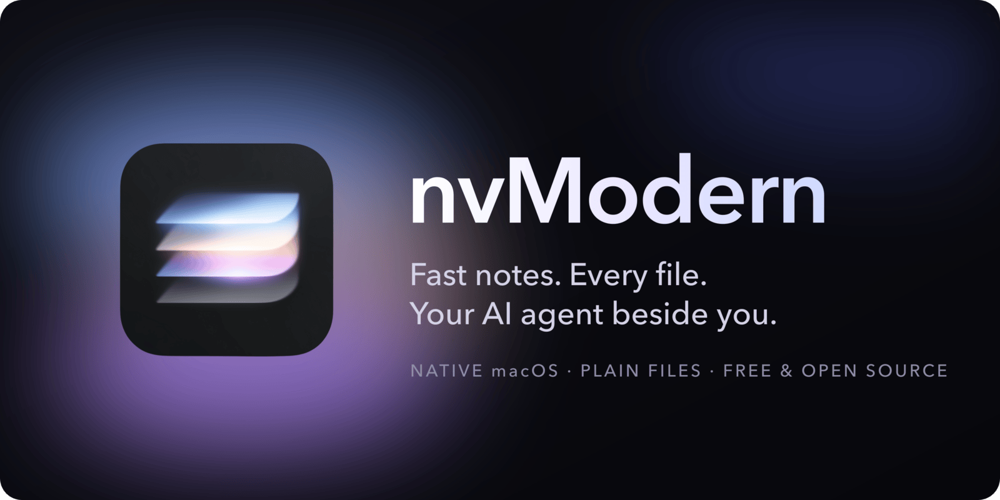
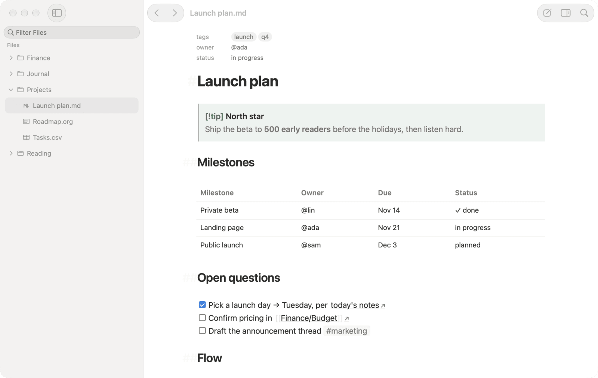
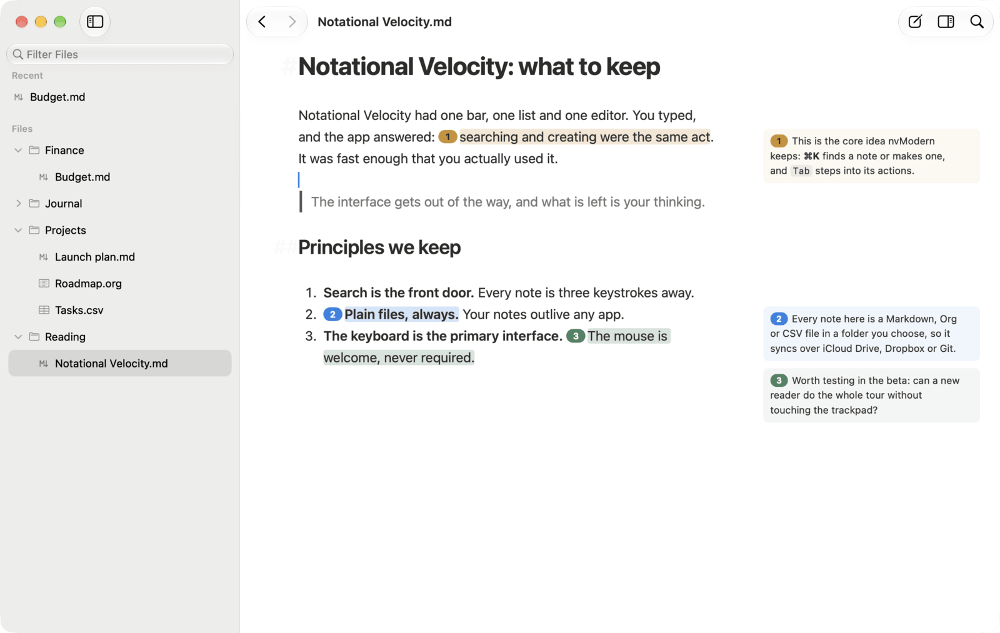
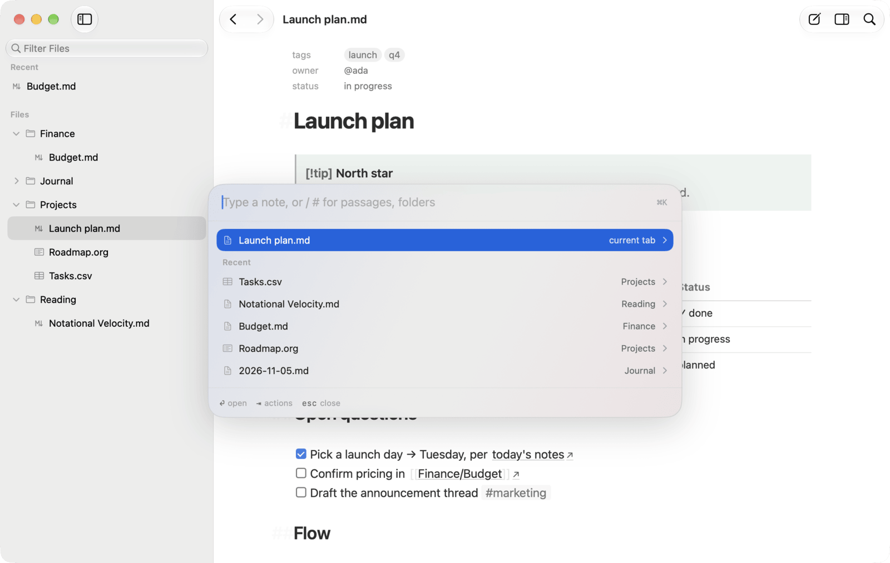
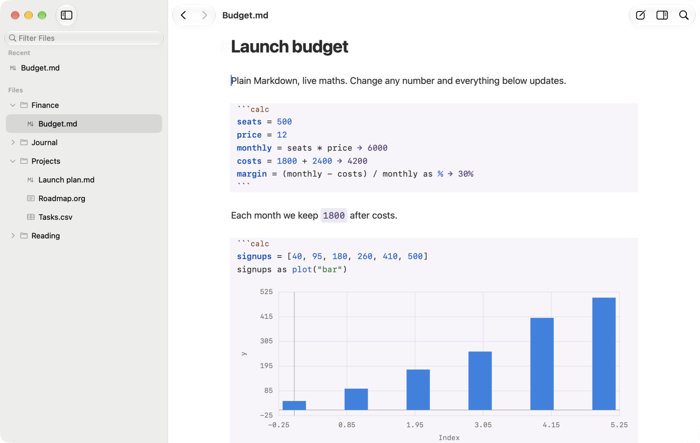
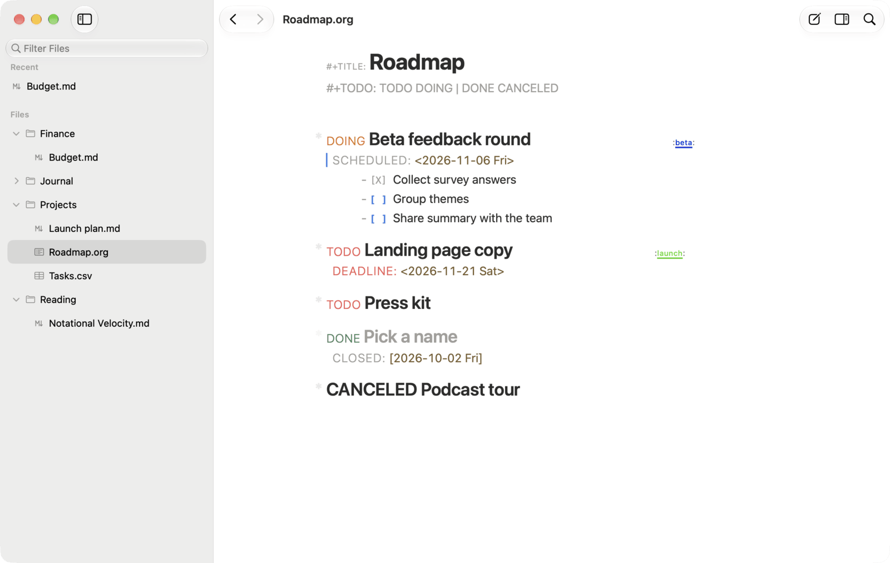
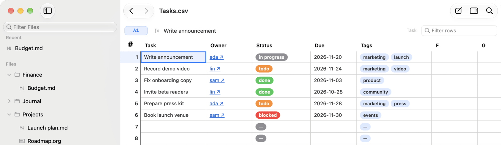

<p align="center">
  
</p>

<h3 align="center">Obsidian, if Apple had made it.</h3>

<p align="center">
  nvModern is a native Mac app for notes and documents. It has the keyboard speed of Notational Velocity, keeps your work in plain files, and connects to your AI agent.
</p>

<p align="center">
  <a href="https://github.com/pier20-ai/nvmodern/releases/latest/download/nvModern.dmg"><b>Download for macOS</b></a>
  &nbsp;·&nbsp;
  <a href="docs/features.md">Every feature</a>
  &nbsp;·&nbsp;
  <a href="#your-ai-agent-built-in">Connect your agent</a>
  &nbsp;·&nbsp;
  <a href="CONTRIBUTING.md">Contribute</a>
</p>

<p align="center">
  
  
  
  
</p>

<p align="center">
  
</p>

One app covers Markdown and Org notes, live maths, CSV spreadsheets, PDFs, EPUBs and Excalidraw canvases. Everything is driven from the keyboard and stored as ordinary files in a folder you choose.

| 27 | ~90 | 10 | 13+ | 0 |
|:---:|:---:|:---:|:---:|:---:|
| MCP tools for your agent | actions, each bindable to a key | typographic themes | file types | accounts or databases |

## Your AI agent, built in

nvModern includes an MCP server, so Claude Code, Codex and other MCP clients can work inside your notes. Connect Claude Code with one command:

```sh
claude mcp add nvmodern -- /Applications/nvModern.app/Contents/MacOS/nv3 mcp
```

Your agent can then see which note you have open, what you have selected and which tabs are open. It can search your workspace, open and create notes, and edit your selection. Here are some requests that work today:

- "Read the PDF I have open and mark the three weakest claims." The agent highlights each passage and writes its explanation in the margin.
- "Answer the questions I left in this draft." You leave a question by selecting a passage and pressing `⌘⇧M`, and the agent answers in place.
- "Find everything I've written about pricing and draft a one-page summary."
- "Open the spec next to my notes." The agent puts it in the side stack beside the note you are reading.

Margin notes are drawn over the document and are never saved into the file. They work in Markdown, Org, plain text and PDF.

<p align="center">
  
</p>

## The speed of Notational Velocity

In Notational Velocity and nvALT, one search box both found notes and created them. nvModern keeps that idea and adds actions you can apply to whatever you found. A command is written as a subject, then a verb, then an object.

| You press | Result |
|---|---|
| `⌘K` `laun` `Return` | Opens *Launch plan* |
| `⌘K` `⌘K` `refile` `Tab` `arch` `Return` | Moves the current note to *Archive* |
| `⌘K` `/pricing` `Tab` `quote` | Quotes a passage you found into the note you are writing |
| `⌘M`, `Space` on each note, `Tab` | Selects several notes and acts on all of them |
| `⌘⇧F` `contract ext:pdf` | Runs a full-text search that includes PDFs |

The app also has real AppKit window tabs, Miller columns, and a side stack for reading two notes at once. When you relaunch, it restores your windows, tabs and scroll positions. Every command in the palette can be bound to a key.

<p align="center">
  
</p>

## Live maths in Markdown

A `calc` block turns part of a note into a calculator. When you change a number, every result that depends on it updates. Values carry types and units.

````markdown
```calc
seats = 500
price = 12
monthly = seats * price          → 6000
margin = (monthly - 4200) / monthly as %   → 30%

10m/s as km/h                    → 36km/h
1kg + 2m                         # error: incompatible dimensions
1//3 + 1//6                      → 1//2
symbol x
x^2 + 3*x @diff(x)               → 2*x + 3
[n^2 for n in range(5) if n > 1] → [4, 9, 16]
signups = [40, 95, 180, 260, 410, 500]
signups as plot("bar")           # draws a bar chart inline
```
````

Calc supports exact fractions, complex numbers, unit conversion with dimension checks, symbolic algebra, list comprehensions, pipes, your own functions and inline plots. Results are written back as text after the `→`, so the file reads correctly in any editor and on GitHub. `F1` opens a reference with examples you can insert.

<p align="center">
  
</p>

## Every file type in one workspace

Your workspace is a normal folder on disk. You can keep it in iCloud Drive, Dropbox or a Git repository. nvModern notices changes made on other devices or in other editors and updates the open documents.

| Type | What you get |
|---|---|
| **Markdown** | Callouts, editable tables, footnotes, LaTeX, Mermaid diagrams, frontmatter shown as properties, highlights, tags and @mentions |
| **Org mode** | TODO states taken from your `#+TODO:` line, SCHEDULED and DEADLINE dates, property drawers, structural lists and tables, all without Emacs |
| **Links** | `[[wikilinks]]` to headings and blocks, block references, and transclusions you can edit in place, which save back to the original note |
| **CSV** | A native spreadsheet with formulas, row filtering, status pills, tag chips and wikilinks in cells; saving keeps the file's encoding and line endings |
| **PDF** | Remembered scroll position, an outline, full-text search, and annotations stored outside the file |
| **EPUB** | A sandboxed reader with a table of contents |
| **Canvases** | Excalidraw drawings in a native tab |
| **Diffs** | Split or unified comparison of two Markdown files |
| **Outlines** | Arbor, a block outliner with Datalog queries, currently in preview |
| **Other files** | Images, HTML, and source code with highlighting for more than 14 languages |

<p align="center">
  
  
</p>

## Themes, plugins and scripting

**Themes.** nvModern ships ten typographic themes. You can set a theme for one document, for a file type or for everything, and you can [write your own in CSS](NVModern/WebEditor/THEMING.md).

| Theme | Style |
|---|---|
| Newsprint | Editorial serif |
| Laurenziana | A Renaissance reading room |
| Riso | Two-ink risograph print |
| Cyanotype | A blueprint on a drafting grid |
| Kunsthalle | Swiss poster |
| Dispatch | A modern newspaper |
| Outliner | Classic monospace Org |
| Catppuccin | Latte by day, Mocha by night |
| Nord | Arctic blues |
| Mayfair | Private-bank stationery |

**Plugins.** Plugins are plain JavaScript files with a typed API. A plugin can register commands, keybindings and system-wide hotkeys, open floating capture panels and always-on-top scratchpads, read and write files, and add its own settings. The repository includes [example plugins](NVModern/Plugins/examples/) for quick capture, daily notes and an Org-style capture datetree.

**Scripting.** The palette, keybindings, plugins, the shell and MCP all call the same set of about 90 actions. From a terminal, for example, you can run `nv3 action workspace.search.query --query inbox`.

**Configuration.** Settings and `~/.config/nvmodern/config.toml` stay in sync in both directions.

## How it compares

| | nvModern | Obsidian | Notion | nvALT |
|---|:---:|:---:|:---:|:---:|
| Native Mac app (AppKit, not Electron) | Yes | No | No | Yes |
| Notes are plain files you own | Yes | Yes | No | Yes |
| Markdown and Org mode built in | Yes | No | No | No |
| Live maths with units built in | Yes | No | No | No |
| CSV spreadsheet, PDF, EPUB and canvas in one app | Yes | Partly | Partly | No |
| MCP server for your AI agent built in | Yes | No | Yes | No |
| Free and open source | Yes | No | No | Yes |

"Built in" means available without third-party plugins. Obsidian has community plugins for several of these features.

## Get started

1. [Download nvModern](https://github.com/pier20-ai/nvmodern/releases/latest/download/nvModern.dmg) and drag it to Applications.
2. Open **Settings → Workspaces → Add Workspace…** and choose a folder. An existing Obsidian vault or any folder of `.md` and `.org` files works as it is.
3. Try the keys below.

| Keys | Action |
|---|---|
| `⌘T` | Opens a new tab with the folder browser |
| `⌘K` | Finds a note |
| `⌘K` `⌘K` | Lists everything you can do with the current note |
| `⌘⇧O` | Jumps to a heading, with a live preview |
| Shift-click a `[[link]]` | Opens the linked note in the side stack |
| `⌘;` then `.` | Inserts today's date; `D` instead opens a date picker |
| `⌘⇧M` | Asks your agent about the selection |
| `⌘\` | Sets the theme, width and text size for this document |
| `F1` | Opens help |

Releases are signed and notarized, and they update automatically. nvModern requires macOS 14 or later on an Apple Silicon Mac.

**Current limitations.** Capture and daily notes are provided as example plugins rather than built-in features. Arbor's computed blocks require [Racket](https://racket-lang.org). Intel Macs are not supported. The full list is in [features.md](docs/features.md).

## Contributing

nvModern is developed in the open under the GPL. We welcome bug reports, themes, plugins and pull requests.

```sh
make setup   # checks for Xcode, XcodeGen and Bun, and installs what it can
make run     # builds and launches the app
```

[CONTRIBUTING.md](CONTRIBUTING.md) explains the tests and project rules. [`docs/architecture/`](docs/architecture/) describes how the parts of the app fit together.

## Credits and licence

nvModern builds on ideas from [Notational Velocity](https://notational.net) and nvALT, and on open-source projects including CodeMirror, Excalidraw, KaTeX, uniorg and Sparkle. The [NOTICE](NOTICE) file lists them all. nvModern is free software under the [GNU General Public License v3.0 or later](LICENSE). Please report security issues privately, as described in [SECURITY.md](SECURITY.md).
